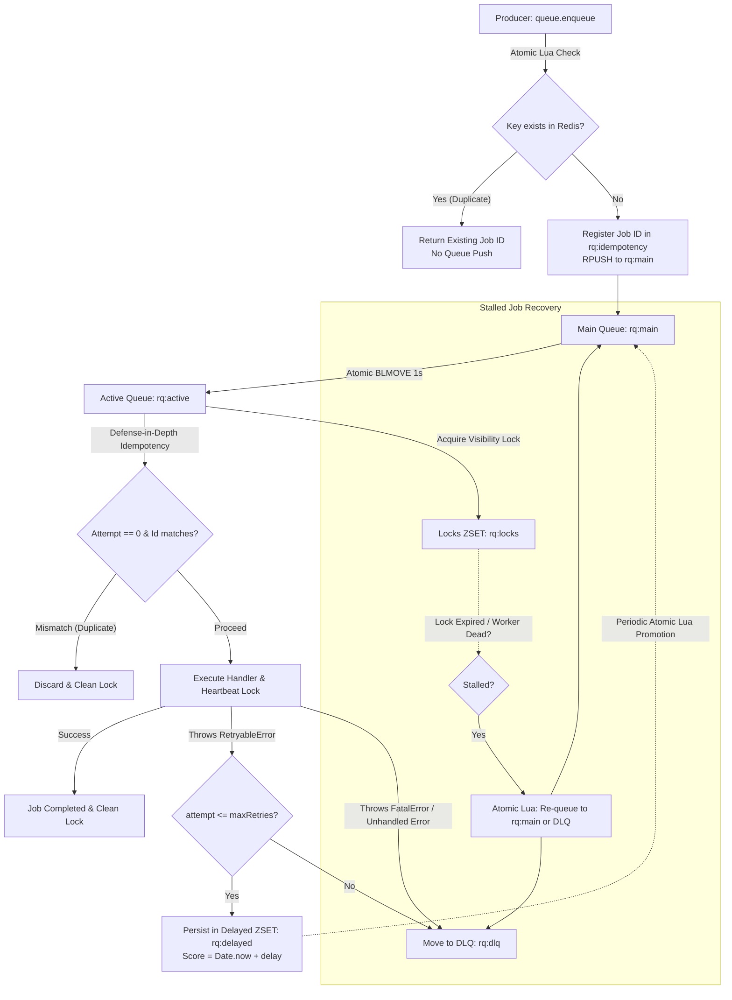
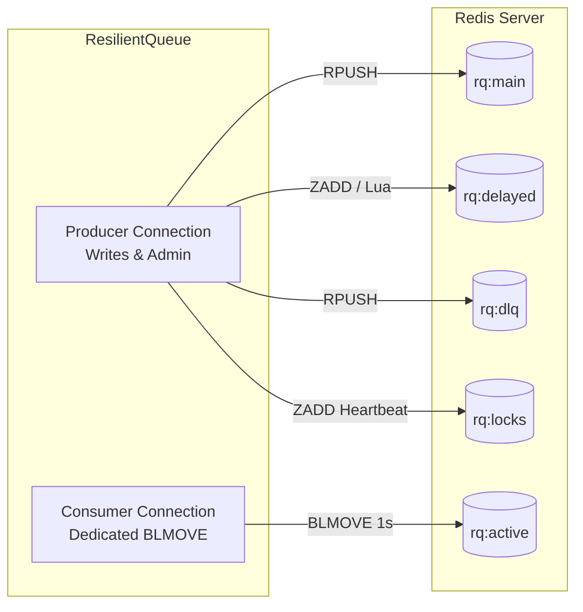

> [!NOTE]
> **Maintenance Mode**: This project is in maintenance mode. Contributions, bug fixes, and improvements are welcome! Please check out [CONTRIBUTING.md](./CONTRIBUTING.md) to get started.

# @mayurbhusare/resilient-queue

[](https://www.npmjs.com/package/@mayurbhusare/resilient-queue)
[](./LICENSE)
[](https://www.npmjs.com/package/@mayurbhusare/resilient-queue)
[](https://nodejs.org)
[](https://github.com/bhusareMayur/resilient-queue)
[](https://redis.io)

A lightweight, production-grade, Redis-backed job queue for Node.js.

Built for resilience, **`@mayurbhusare/resilient-queue`** provides **crash-proof in-flight job durability (stalled recovery)**, **persistent exponential backoff retries**, **atomic delayed retry scheduling**, **Dead-Letter Queue (DLQ)** routing, **idempotency guarantees**, **in-memory worker concurrency**, and **graceful shutdown** — all with zero framework bloat and only two lean dependencies (`ioredis` and `uuid`).

---

## Table of Contents

- [Features](#-features)
- [Architecture & How It Works](#-architecture--how-it-works)
- [Installation](#-installation)
- [Quick Start](#-quick-start)
- [Core Concepts & Usage](#-core-concepts--usage)
  - [Producer (Enqueuing Jobs)](#1-producer-enqueuing-jobs)
  - [Consumer (Processing Jobs & Concurrency)](#2-consumer-processing-jobs--concurrency)
  - [Job Object Anatomy](#3-job-object-anatomy)
  - [Stalled Job Protection & Worker Crash Recovery](#4-stalled-job-protection--worker-crash-recovery)
  - [Error Handling: Retryable vs. Fatal](#5-error-handling-retryable-vs-fatal)
  - [Crash-Durable Delayed Retries](#6-crash-durable-delayed-retries)
  - [Dead Letter Queue (DLQ)](#7-dead-letter-queue-dlq)
  - [Idempotency & Expiration (TTL)](#8-idempotency--expiration-ttl)
  - [Dual Redis Connection Architecture](#9-dual-redis-connection-architecture)
  - [Graceful Shutdown](#10-graceful-shutdown)
- [Complete API Reference](#-complete-api-reference)
- [Redis Keys Layout](#-redis-keys-layout)
- [Testing](#-testing)
- [Contributing](#-contributing)
- [License](#-license)

---

## ✨ Features

- 🚀 **Lightweight & Fast**: Built directly on top of `ioredis` with no heavy abstractions or multi-megabyte dependencies.
- 🛡️ **Zero Data Loss on Crash (Stalled Recovery)**: Uses atomic `BLMOVE` (with `BRPOPLPUSH` fallback) to move in-flight jobs to `rq:active`. Even if your worker process suffers a hard crash (OOM, `SIGKILL`, server reboot), an active visibility heartbeat detects stalled jobs and automatically recovers them!
- 🔁 **Exponential Backoff**: Configurable retry limit and base delay with automatic exponential backoff (`baseDelay * 2^attempt`).
- 💾 **Crash-Durable Retries**: Scheduled retries are stored in Redis Sorted Sets (`rq:delayed`) and promoted atomically via Lua scripts. Even if your worker crashes or restarts, scheduled retries are never lost!
- ☠️ **Dead Letter Queue (DLQ)**: Automatically moves fatal errors, exhausted retries, or poison pill stalled jobs exceeding `maxStalledCount` to `rq:dlq` with failure timestamps and reasons.
- 🔒 **Idempotency Protection**: Built-in at-most-once processing with optional TTL expiration to safely deduplicate incoming jobs without blocking subsequent retries or recovered crashed jobs.
- ⚡ **Controlled Concurrency**: Configurable in-memory worker pool (`concurrency: N`) using an efficient single-fetcher loop with `Promise.race` backpressure to prevent Redis socket exhaustion.
- 🔌 **Flexible Redis Connections & Dual Connection Design**: Connect via Redis URL, standard `ioredis` options (including TLS and Sentinel), Redis Cluster, or existing client instances with safe connection ownership management and dedicated producer/consumer connection separation.
- 🛑 **Graceful Shutdown**: Built-in `queue.close()` and `queue.stop()` to drain active in-flight jobs and disconnect cleanly without data loss.

---

## 🧠 Architecture & How It Works



### Lifecycle Highlights:
1. **Atomic Enqueuing & Idempotency**: Jobs receive a candidate UUID. If an `idempotencyKey` is supplied, an atomic Redis Lua script checks whether the key is already registered. If it exists, the existing job ID is returned immediately without creating a duplicate queue entry. If not, the candidate job ID is registered (with optional TTL) and pushed to `rq:main` in a single atomic Redis operation.
2. **Atomic Dequeuing**: Workers fetch jobs using Redis `BLMOVE` (Redis 6.2+) or `BRPOPLPUSH` into `rq:active`. Jobs are **never deleted from Redis during execution**.
3. **Visibility Lock & Heartbeat**: When picked up, a lock is registered in `rq:locks` with an expiration timestamp (`Date.now() + lockDuration`). A lightweight background heartbeat continually renews the lock while the job is executing.
4. **Stalled Job Recovery**: If a worker crashes or is killed (`SIGKILL`, OOM, reboot), its heartbeat stops. The queue's recovery scheduler inspects `rq:locks`, automatically re-queues abandoned jobs back into `rq:main`, or routes poison pills to `rq:dlq` if `maxStalledCount` is exceeded.
5. **Idempotency Defense-in-Depth**: On initial execution (`attempt === 0` and `stalledCount === 0`), workers verify that the active job ID matches the registered idempotency key before running the handler. Retries and recovered jobs bypass this check.
6. **Execution & Finalization**: Upon completion or failure, the job is atomically removed from `rq:active` and its visibility lock is released.
7. **Crash-Durable Retries**: If the handler throws a `RetryableError` and attempts remain, the job is persisted to `rq:delayed` (a Redis ZSET) and promoted back via atomic Lua script.
8. **Dead Lettering**: If a job exhausts all retries, throws a `FatalError`, or repeatedly crashes workers beyond `maxStalledCount`, it is routed immediately to `rq:dlq`.

---

## 📦 Installation

```bash
# npm
npm install @mayurbhusare/resilient-queue

# yarn
yarn add @mayurbhusare/resilient-queue

# pnpm
pnpm add @mayurbhusare/resilient-queue
```

---

## 🚀 Quick Start

```javascript
const {
  ResilientQueue,
  RetryableError,
  FatalError
} = require("@mayurbhusare/resilient-queue");

// 1. Initialize Queue
const queue = new ResilientQueue({
  redisUrl: "redis://127.0.0.1:6379",
  maxRetries: 3,
  baseDelay: 500,    // 500ms base delay
  keyPrefix: "rq"     // Default Redis prefix
});

// 2. Start Processing Jobs (Worker)
queue.process(async (job) => {
  console.log(`[Job ${job.id}] Processing:`, job.data);

  if (job.data.shouldRetry) {
    // Retried with exponential backoff: 1s, 2s, 4s...
    throw new RetryableError("External service unavailable");
  }

  if (job.data.isCorrupt) {
    // Immediately moves to DLQ without retrying
    throw new FatalError("Invalid payload data");
  }

  console.log(`[Job ${job.id}] Completed successfully!`);
}, { concurrency: 2 });

// 3. Enqueue Jobs (Producer)
async function main() {
  const jobId = await queue.enqueue(
    { email: "user@example.com", template: "welcome" },
    { idempotencyKey: "welcome-user-123", ttlSeconds: 86400 }
  );

  console.log("Enqueued job with ID:", jobId);
}

main().catch(console.error);
```

---

## 💡 Core Concepts & Usage

### 1. Producer (Enqueuing Jobs)

Enqueue arbitrary JSON-serializable payloads. `enqueue()` returns a promise that resolves to the auto-generated unique job UUID:

```javascript
const jobId = await queue.enqueue({
  orderId: "order_9981",
  amount: 49.99
});

console.log("Created job ID:", jobId); // e.g. "550e8400-e29b-41d4-a716-446655440000"
```

To prevent duplicate job processing, supply an `idempotencyKey` and an optional expiration `ttlSeconds`:

```javascript
await queue.enqueue(
  { transactionId: "txn_abc123", amount: 100 },
  {
    idempotencyKey: "txn_abc123",
    ttlSeconds: 3600 // Expire idempotency lock after 1 hour
  }
);
```

---

### 2. Consumer (Processing Jobs & Concurrency)

Register an asynchronous handler with `queue.process(handler, options)`.

```javascript
queue.process(async (job) => {
  await sendNotification(job.data);
}, {
  concurrency: 5 // Process up to 5 jobs concurrently in this worker
});
```

#### Why In-Memory Concurrency Matters:
Unlike naive queue implementations that open a separate Redis socket per concurrent worker (leading to connection exhaustion and socket bottlenecks), `ResilientQueue` uses a **single consumer connection** with an internal in-memory active job set and `Promise.race` backpressure. When the active job limit is reached, fetching temporarily pauses until a slot opens up.

---

### 3. Job Object Anatomy

The `job` argument provided to your handler contains the following structure:

```json
{
  "id": "c1f7a0b2-9d33-4f27-a068-154df67f62c0",
  "data": {
    "userId": 42,
    "action": "send_welcome_email"
  },
  "attempt": 0,
  "idempotencyKey": "welcome-42",
  "ttlSeconds": 86400,
  "createdAt": 1713000000000,
  "lastError": "SMTP timeout",
  "retriedAt": 1713000001000
}
```

| Property | Type | Description |
| :--- | :--- | :--- |
| `id` | `string` | Unique UUID v4 for the job. |
| `data` | `any` | The payload passed during `enqueue()`. |
| `attempt` | `number` | Number of retries already executed (`0` on initial try, `1`, `2`, ... on retries). |
| `stalledCount` | `number \| undefined` | Number of times this job was recovered after a worker crash or heartbeat timeout. |
| `idempotencyKey` | `string \| null` | The idempotency key, if provided. |
| `ttlSeconds` | `number \| null` | The idempotency TTL in seconds, if specified. |
| `createdAt` | `number` | Unix timestamp (in milliseconds) when the job was created. |
| `lastError` | `string \| undefined` | The error message from the previous failed attempt (available on retries). |
| `retriedAt` | `number \| undefined` | Unix timestamp (in milliseconds) of the most recent retry attempt. |
| `lastStalledAt` | `number \| undefined` | Unix timestamp (in milliseconds) of the most recent stalled recovery. |

---

### 4. Stalled Job Protection & Worker Crash Recovery

In standard Redis queues using `BLPOP`, if a worker process crashes (OOM killer, `SIGKILL`, hardware failure, unhandled rejection) while executing a job, **that job is lost forever**.

`@mayurbhusare/resilient-queue` solves this with the **Reliable Queue Pattern + Active Visibility Heartbeat**:

1. **Atomic Dequeue**: Jobs are moved atomically from `rq:main` to `rq:active` using `BLMOVE` (or `BRPOPLPUSH`). The job is **never removed from Redis during execution**.
2. **Per-Dequeue Fencing Token**: Each worker execution generates a unique `lockToken` recorded in `rq:lock_tokens`. Stale workers that experienced network delays or GC pauses are **fenced**: their heartbeats and release calls cannot overwrite or delete a successor worker's lock or active queue entry!
3. **Visibility Lock & Heartbeat**: The worker registers a lock in `rq:locks` (`Date.now() + lockDuration`). A non-blocking background heartbeat continually renews this lock as long as the worker holds the valid lease.
4. **Surfacing Lease Loss via AbortSignal**: If a worker loses its lease (e.g. heartbeat timeout or recovery takeover), `job.isLeaseLost` is set to `true` and `job.signal` (standard `AbortSignal`) is automatically aborted. Handlers can pass `job.signal` to abort-aware APIs (like `fetch` or database clients) to cancel running operations immediately.
5. **Automatic Recovery**: If the worker process dies or hangs, the heartbeat ceases. An internal recovery scheduler runs an atomic Lua script that revokes the expired token, re-queues abandoned jobs back into `rq:main`, and ensures no job is lost.
6. **Poison Pill Protection**: If a malformed payload repeatedly crashes worker processes, the queue tracks `stalledCount`. If `stalledCount > maxStalledCount` (default: `1`), the job is safely diverted straight to `rq:dlq` with a diagnostic failure reason, preventing infinite crash loops!

> [!WARNING]
> **Idempotent Handlers Required**: While per-dequeue fencing tokens prevent a stale worker from corrupting Redis locks or active queue state, lease fencing **cannot forcibly terminate** arbitrary in-flight asynchronous code or external API calls already in flight. Your job handlers and downstream operations **must be designed to be idempotent** (or use an `idempotencyKey`) and should check `job.signal.aborted` or `job.signal.throwIfAborted()` where appropriate.

---

### 5. Error Handling: Retryable vs. Fatal

`@mayurbhusare/resilient-queue` makes an intentional distinction between transient failures and non-recoverable errors:

```javascript
const { RetryableError, FatalError } = require("@mayurbhusare/resilient-queue");

queue.process(async (job) => {
  try {
    await callThirdPartyAPI(job.data);
  } catch (err) {
    if (err.isRateLimited || err.code === "ECONNRESET") {
      // ⏳ Transient error: retried up to maxRetries
      throw new RetryableError(`Rate limit reached: ${err.message}`);
    }

    // 🛑 Fatal error: moved straight to DLQ, skipping retries
    throw new FatalError(`Unrecoverable response: ${err.message}`);
  }
});
```

> [!IMPORTANT]
> **DLQ by Default for Non-Retryable Errors**: If your handler throws an unhandled standard `Error` (or a `FatalError`) that does **not** inherit from `RetryableError`, the queue treats it as permanent and routes the job directly to the DLQ on the very first attempt. Only errors explicitly inheriting from `RetryableError` undergo exponential retry.

---

### 6. Crash-Durable Delayed Retries

When a `RetryableError` is thrown, the retry delay is calculated using exponential backoff:

$$\text{delay} = \text{baseDelay} \times 2^{\text{attempt}}$$

| Attempt | Multiplier | Delay (with default `baseDelay: 500ms`) |
| :---: | :---: | :---: |
| 1st retry | $500 \times 2^1$ | **1,000 ms** (1.0 s) |
| 2nd retry | $500 \times 2^2$ | **2,000 ms** (2.0 s) |
| 3rd retry | $500 \times 2^3$ | **4,000 ms** (4.0 s) |

#### How Delayed Retries Survive Process Restarts
Instead of keeping delayed jobs in transient Node.js `setTimeout` memory timers, `ResilientQueue` persists delayed jobs into a Redis Sorted Set (`<keyPrefix>:delayed`) where the **score is the execution timestamp** (`Date.now() + delay`).

- A background scheduler inspects `<keyPrefix>:delayed` and runs an atomic Lua script that safely promotes due jobs back into `<keyPrefix>:main`.
- If your server reboots, worker process restarts, or the app is redeployed, **no scheduled retries are lost**. Due jobs are promoted and picked up immediately upon restart!

---

### 7. Dead Letter Queue (DLQ)

When a job either exceeds `maxRetries` or encounters a fatal non-retryable error, it is moved to the Dead Letter Queue:

```text
rq:dlq
```

Each entry in `rq:dlq` preserves the entire original job payload along with failure diagnostics:
```json
{
  "id": "e0b9b32a-5b12-429a-9e11-cf9787e91d89",
  "data": { "chargeId": "ch_123" },
  "attempt": 4,
  "idempotencyKey": "charge_ch_123",
  "ttlSeconds": null,
  "createdAt": 1713000000000,
  "lastError": "Gateway timeout",
  "retriedAt": 1713000008000,
  "failedAt": 1713000016000,
  "failureReason": "Gateway timeout"
}
```

#### Inspecting the DLQ
You can inspect or drain the DLQ directly using any Redis client or `ioredis`:

```javascript
const Redis = require("ioredis");
const redis = new Redis("redis://127.0.0.1:6379");

async function checkDeadLetterQueue() {
  // Fetch the latest 10 failed jobs
  const failedJobsRaw = await redis.lrange("rq:dlq", 0, 9);
  const failedJobs = failedJobsRaw.map((raw) => JSON.parse(raw));

  console.log(`Found ${failedJobs.length} failed jobs in DLQ:`);
  failedJobs.forEach((job) => {
    console.error(`Job ${job.id} failed after ${job.attempt} attempts: ${job.failureReason}`);
  });
}
```

---

### 8. Idempotency & Expiration (TTL)

To guarantee **at-most-once** delivery across distributed producers and retries:

```javascript
const jobId = await queue.enqueue(
  { invoiceId: "INV-2026-001" },
  {
    idempotencyKey: "invoice:INV-2026-001",
    ttlSeconds: 86400 // Key expires after 24 hours
  }
);
```

#### How it works:
1. **Atomic Enqueue-Time Deduplication**: When `queue.enqueue()` receives an `idempotencyKey`, it executes an atomic Redis Lua script.
   - If the key is **already registered**, Redis returns the existing job ID immediately. No duplicate job is pushed to the queue, avoiding queue pollution, wasted memory, and redundant worker consumption.
   - If the key is **new**, Redis registers the key mapped to the candidate job ID (with optional TTL expiration) and atomically pushes the job payload to `rq:main`.
2. **Deterministic Return Contract**: Concurrent or repeated calls to `queue.enqueue()` with the same `idempotencyKey` always return the exact same original job ID while the idempotency key remains active.
3. **TTL Expiration (`ttlSeconds`)**:
   - Supplying a positive integer (e.g. `ttlSeconds: 86400`) configures the idempotency key to expire in Redis after that duration. Once expired, a new job with the same key can be enqueued.
   - When omitted, `0`, or non-positive, the idempotency key persists indefinitely in Redis.
4. **Defense-in-Depth Dequeue Verification**: When workers execute a job for the first time (`attempt === 0`), they verify the job ID matches the registered key. If an unexpected duplicate enters the queue (e.g. legacy producers), it is safely discarded.
5. **Retries & Stalled Recovery Are Never Blocked**: Once a job is processing, subsequent retries (`job.attempt > 0`) or recovered crashed jobs (`job.stalledCount > 0`) bypass idempotency checks, ensuring execution runs to completion.

---

### 9. Dual Redis Connection Architecture & Flexible Connections

`ResilientQueue` initializes two distinct Redis connections under the hood:



- **Producer Connection**: Dedicated to immediate, non-blocking commands (`RPUSH`, `SET`, `ZADD`, `eval`, `quit`).
- **Consumer Connection**: Exclusively reserved for blocking reads (`BLMOVE` / `BRPOPLPUSH`).

Because blocking reads hold the connection socket open while waiting for new jobs, isolating the producer ensures your application can always enqueue new jobs, promote retries, or write to the DLQ with zero blocking delay.

#### Flexible Connection Options

`ResilientQueue` supports standard Redis connection formats, secure endpoints, high-availability deployments, and pre-existing client instances:

```javascript
// 1. Connection URL string (backward compatible with redisUrl)
const queue = new ResilientQueue({
  redis: "redis://127.0.0.1:6379"
});

// 2. Standard ioredis options (including TLS)
const queue = new ResilientQueue({
  redis: {
    host: "redis.internal.example.com",
    port: 6380,
    password: "auth-token",
    tls: { rejectUnauthorized: true }
  }
});

// 3. Redis Sentinel High Availability
const queue = new ResilientQueue({
  redis: {
    sentinels: [
      { host: "sentinel-1.example.com", port: 26379 },
      { host: "sentinel-2.example.com", port: 26379 }
    ],
    name: "mymaster"
  }
});

// 4. Existing Redis Client Instance
const existingClient = new Redis("redis://127.0.0.1:6379");
const queue = new ResilientQueue({
  redis: existingClient // Producer uses existingClient; Consumer is automatically duplicated
});

// 5. Redis Cluster Configuration
const queue = new ResilientQueue({
  cluster: [
    { host: "10.0.0.1", port: 7000 },
    { host: "10.0.0.2", port: 7000 }
  ],
  keyPrefix: "{rq}" // REQUIRED for Redis Cluster (see Hash Slot Requirements below)
});
```

#### Connection Ownership & Lifecycle

`ResilientQueue` strictly respects connection ownership:
- **Queue-Owned Connections**: Connections created by the library (via URL, connection options, cluster nodes, or duplicate calls) are automatically disconnected when `queue.close()` is called.
- **Externally Owned Clients**: If you pass an existing `Redis` or `Cluster` instance into `ResilientQueue` (e.g. `redis: existingClient`), the library will **never close** your external client. When `queue.close()` runs, only the internal duplicated consumer is closed, leaving your external client open and responsive for the rest of your application.

#### Redis Cluster Support & Limitations

`ResilientQueue` supports Redis Cluster configurations, but requires single-slot key locality:

> [!WARNING]
> **Redis Cluster Hash Slot Requirement**: ResilientQueue uses atomic multi-key Lua scripts (`eval`) and atomic list migrations (`BLMOVE`). In Redis Cluster, all keys evaluated within a single script or command **must map to the exact same hash slot**.
> 
> When configuring ResilientQueue on Redis Cluster, you **must wrap the key prefix in a Redis hash tag `{...}`**, for example:
> ```javascript
> const queue = new ResilientQueue({
>   cluster: [{ host: "127.0.0.1", port: 7000 }],
>   keyPrefix: "{my-queue}" // Hashes all queue keys ({my-queue}:main, {my-queue}:active, etc.) to the same slot
> });
> ```
> Without hash tags in `keyPrefix`, Redis Cluster will reject operations with `CROSSSLOT Keys in request don't hash to the same slot`.
>
> **Multi-Shard Limitation**: Using a hash tag guarantees transactional atomicity by pinning all keys for that specific queue to a single Redis Cluster node/shard. A single queue cannot be partitioned or distributed across multiple cluster shards.

---

### 10. Graceful Shutdown

In production environments (Kubernetes, Docker, PM2, systemd), workers need to finish executing in-flight jobs when a termination signal is received:

```javascript
// Clean shutdown hook
async function handleShutdown() {
  console.log("Shutting down worker gracefully...");
  
  // Stops fetching new jobs, awaits in-flight jobs, and closes queue-owned Redis connections
  await queue.close();
  
  console.log("Worker closed cleanly.");
  process.exit(0);
}

process.on("SIGTERM", handleShutdown);
process.on("SIGINT", handleShutdown);
```

- `queue.stop()`: Halts job consumption, pauses retry schedulers, and waits for all in-flight jobs to settle.
- `queue.close()`: Executes `queue.stop()` and safely closes queue-owned Redis connections (`producer.quit()` and `consumer.quit()`). Externally provided clients are left untouched.

---

## 📖 Complete API Reference

### `new ResilientQueue(options)`

Creates a new queue instance.

| Option | Type | Default | Description |
| :--- | :--- | :--- | :--- |
| `redis` | `string \| object \| Redis \| Cluster` | *(Optional)* | Connection URL string, standard `ioredis` options object, existing Redis/Cluster client instance, or cluster configuration. |
| `redisUrl` | `string` | *(Optional)* | Redis connection URL (e.g. `"redis://127.0.0.1:6379"`). Preserved for backward compatibility. |
| `cluster` | `Array \| object` | *(Optional)* | Redis Cluster node array `[{ host, port }]` or `{ nodes, options }` configuration object. |
| `clusterNodes` | `Array` | *(Optional)* | Array of Redis Cluster nodes. |
| `clusterOptions` | `object` | *(Optional)* | Configuration options for Redis Cluster. |
| `client` | `Redis \| Cluster` | *(Optional)* | Pre-existing Redis or Cluster client instance. |
| `producer` | `Redis \| Cluster \| object \| string` | *(Optional)* | Explicit client instance or connection options for the producer connection. |
| `consumer` | `Redis \| Cluster \| object \| string` | *(Optional)* | Explicit client instance or connection options for the blocking consumer connection. |
| `maxRetries` | `number` | `3` | Maximum number of retries before routing a failed job to DLQ. |
| `baseDelay` | `number` | `500` | Base retry delay in milliseconds for exponential backoff (`baseDelay * 2^attempt`). |
| `keyPrefix` | `string` | `"rq"` | Namespace prefix for Redis keys. **Note:** On Redis Cluster, must contain a hash tag like `"{rq}"` to avoid cross-slot errors. |
| `stalledInterval` | `number` | `15000` | Interval in ms between stalled job recovery checks. |
| `lockDuration` | `number` | `30000` | Visibility lock timeout in ms before an active job is considered abandoned. |
| `maxStalledCount` | `number` | `1` | Max times a job can crash and be recovered before moving to DLQ (poison pill protection). |

---

### `queue.enqueue(data, [options])`

Pushes a new job to the tail of the main queue.

- **Parameters**:
  - `data` (`any`): Any JSON-serializable value representing the job payload.
  - `options` (`object`, optional):
    - `idempotencyKey` (`string`, optional): Unique key for deduplication. Duplicate calls return the existing job ID without inserting another job.
    - `ttlSeconds` (`number`, optional): Time-to-live in seconds for the idempotency key in Redis. A positive integer sets key expiration; `0`, non-positive, or omitted persists indefinitely.
- **Returns**: `Promise<string>` — The auto-generated UUID v4 string of the job (or the existing job ID if `idempotencyKey` was already registered).

---

### `queue.process(handler, [options])`

Starts consuming jobs from the queue.

- **Parameters**:
  - `handler` (`(job: object) => Promise<void>`): Async worker function. Receives the `job` object.
  - `options` (`object`, optional):
    - `concurrency` (`number`, optional): Positive integer specifying how many jobs can run concurrently in this worker. Default: `1`.
- **Returns**: `Promise<void>`

---

### `queue.stop()`

Stops the worker polling loop, clears the retry promotion timer, and waits for currently running in-flight jobs to complete.

- **Returns**: `Promise<void>`

---

### `queue.close()`

Calls `queue.stop()` and gracefully closes both producer and consumer Redis connections.

- **Returns**: `Promise<void>`

---

### `RetryableError`

```javascript
const { RetryableError } = require("@mayurbhusare/resilient-queue");
throw new RetryableError("Temporary failure message");
```
Error class indicating that the job encountered a recoverable failure and should be retried using exponential backoff.

---

### `FatalError`

```javascript
const { FatalError } = require("@mayurbhusare/resilient-queue");
throw new FatalError("Unrecoverable error message");
```
Error class indicating a permanent failure. Bypasses all retries and routes the job directly to the DLQ.

---

## 🗄️ Redis Keys Layout

All keys are namespaced by the configured `keyPrefix` (default: `rq`):

| Redis Key | Type | Description |
| :--- | :---: | :--- |
| `<keyPrefix>:main` | `List` | Primary FIFO queue where new, promoted retries, and recovered jobs await consumption. |
| `<keyPrefix>:active` | `List` | In-flight jobs currently being processed by workers (prevents data loss on crash). |
| `<keyPrefix>:locks` | `Sorted Set` | Active job visibility locks periodically extended by worker heartbeats. |
| `<keyPrefix>:delayed` | `Sorted Set` | Scheduled retries waiting for their delay window to elapse. Score is the Unix timestamp (ms). |
| `<keyPrefix>:dlq` | `List` | Dead Letter Queue holding exhausted, fatal, or poison pill failed jobs with diagnostic metadata. |
| `<keyPrefix>:idempotency:<key>` | `String` | Idempotency key mapping to registered job ID via atomic Lua script with optional TTL expiration (`EX`). |

---

## 🧪 Testing

The library includes an extensive test suite built with **Jest**, covering core queue behavior, retry backoff, DLQ routing, idempotency deduplication, crash recovery of delayed retries, concurrency limits, and graceful shutdown.

### Run Tests:
Ensure a local Redis instance is running on `127.0.0.1:6379`, then run:

```bash
npm test
```

---

## 🤝 Contributing

Contributions, issues, and feature requests are welcome!  
Please see [CONTRIBUTING.md](./CONTRIBUTING.md) for details on branching conventions, code style, and testing guidelines.

---

## 📄 License

This project is licensed under the [MIT License](./LICENSE).

Copyright (c) 2026 Mayur S. Bhusare.