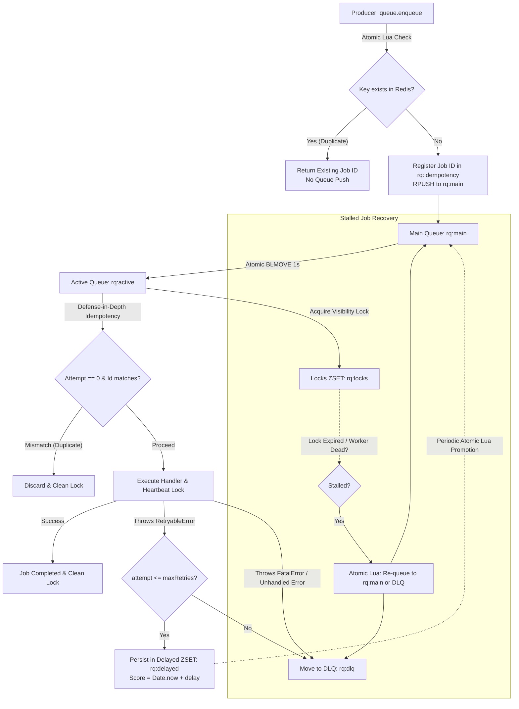

> [!NOTE]
> **Maintenance Mode**: This project is in maintenance mode. Contributions, bug fixes, and improvements are welcome. Please check out [CONTRIBUTING.md](./CONTRIBUTING.md) to get started.

# @mayurbhusare/resilient-queue

[](https://www.npmjs.com/package/@mayurbhusare/resilient-queue)
[](./LICENSE)
[](https://github.com/bhusareMayur/resilient-queue)

A lightweight, production-grade, Redis-backed job queue for Node.js.

Built for resilience, **`@mayurbhusare/resilient-queue`** provides crash-durable in-flight job durability (stalled job recovery), persistent exponential backoff retries, Dead-Letter Queue (DLQ) routing, atomic enqueue-time idempotency guarantees, scheduled delayed jobs, high-throughput pipeline batch enqueuing (`enqueueMany`), real-time queue metrics (`getMetrics`), distributed pause/resume coordination (`pause`, `resume`, `isPaused`), in-memory worker concurrency, and graceful shutdown — with zero framework bloat and only two lean dependencies (`ioredis` and `uuid`).

---

## Features

- **Crash-Proof Job Durability**: Uses atomic `BLMOVE` (with `BRPOPLPUSH` fallback) to move active jobs to `rq:active`. In-flight jobs are never deleted from Redis during processing. If a worker crashes, an active visibility heartbeat detects the abandoned job and safely recovers it.
- **Real-Time Queue Metrics**: Inspect job counts across waiting, active, delayed, and dead-letter queue states (`getMetrics()`) in a single network round-trip using an `ioredis` pipeline.
- **Distributed Pause & Resume**: Pause and resume job consumption locally and across distributed worker processes with atomic Redis coordination (`pause()`, `resume()`, `isPaused()`), active-job draining, and idempotent state transitions.
- **Fencing Tokens & Lease Revocation**: Per-dequeue fencing tokens (`lockToken`) protect against stale workers renewing or releasing successor workers' locks. Lease loss is surfaced to handlers via `job.signal` (`AbortSignal`) and `job.isLeaseLost`.
- **Event Emitter Observability**: Native Node.js `EventEmitter` lifecycle hooks (`completed`, `failed`, `retrying`, `dlq`, `stalled`, `paused`, `resumed`) with safe listener isolation, duplicate prevention, and zero queue corruption.
- **Job Execution Timeouts**: Optional execution timeout (`jobTimeout`) with cooperative cancellation via `AbortSignal`, `JobTimeoutError`, automatic retry/DLQ pipeline routing, and safe lock retention.
- **Scheduled Delayed Jobs**: Schedule jobs directly from `enqueue()` using `{ delay: ms }` or `{ runAt: new Date(...) }` backed by Redis sorted sets (`rq:delayed`) and atomic Lua promotion.
- **High-Throughput Batch Enqueuing (`enqueueMany`)**: Enqueue thousands of jobs in a single network round-trip using an `ioredis` pipeline for 50x–100x throughput boost.
- **Crash-Durable Retries**: Scheduled retries are persisted in a Redis Sorted Set (`rq:delayed`) and promoted via atomic Lua scripts, surviving worker restarts and server reboots.
- **Native Dead-Letter Queue (DLQ) Management**: Automatically moves non-retryable errors, exhausted retries, or repeatedly crashing poison pills exceeding `maxStalledCount` to `rq:dlq` with failure diagnostics. Provides native atomic APIs to inspect (`getDLQ`, `getDLQCount`), atomically retry single or batch jobs with reset failure metadata (`retryDLQJob`, `retryAllDLQ`), remove (`removeDLQJob`), or purge (`purgeDLQ`) with full Redis Cluster hash-slot support and corrupted JSON safety.
- **Atomic Enqueue-Time Idempotency**: Deduplicates incoming jobs at enqueue time via an atomic Lua script with optional TTL expiration (`ttlSeconds`), returning the existing job ID without creating duplicate queue entries.
- **Controlled In-Memory Concurrency**: Single-consumer worker pool (`concurrency: N`) using `Promise.race` backpressure, avoiding Redis connection bottlenecks and socket exhaustion.
- **Flexible Redis Topologies**: Connect via Redis URL, standard `ioredis` options (including TLS and Sentinel), Redis Cluster, or existing client instances with connection ownership tracking.
- **Graceful Shutdown**: Drains active in-flight tasks and disconnects queue-owned connections cleanly on `SIGTERM` or `SIGINT`.
- **TypeScript Support**: Full TypeScript typings included via `index.d.ts`.

---

## Documentation

Comprehensive documentation guides are available in the [`docs/`](./docs/) directory:

- **[Getting Started](./docs/getting-started.md)**: Installation, prerequisites, core concepts, and first worker tutorial.
- **[Configuration Guide](./docs/configuration.md)**: Connection options, TLS, Sentinel, Cluster hash tag requirements, and queue runtime parameters.
- **[API Reference](./docs/api-reference.md)**: Detailed reference for `ResilientQueue`, `RetryableError`, `FatalError`, TypeScript interfaces, and Redis data structures.
- **[Architecture & Internals](./docs/architecture.md)**: Deep dive into the dual-connection model, in-memory concurrency, visibility locks, fencing tokens, and Lua scripts.
- **[Error Handling Guide](./docs/error-handling.md)**: Transient vs fatal errors, exponential backoff progression, poison pill detection, and DLQ management.
- **[Code Examples](./docs/examples.md)**: Practical examples for idempotency, concurrency, custom connections, lease abortion, and DLQ reprocessing.

---

## Installation

```bash
# npm
npm install @mayurbhusare/resilient-queue

# yarn
yarn add @mayurbhusare/resilient-queue

# pnpm
pnpm add @mayurbhusare/resilient-queue
```

---

## Quick Start

```javascript
const {
  ResilientQueue,
  RetryableError,
  FatalError
} = require("@mayurbhusare/resilient-queue");

// 1. Initialize Queue
const queue = new ResilientQueue({
  redisUrl: "redis://127.0.0.1:6379",
  maxRetries: 3,
  baseDelay: 500, // 500ms base delay for exponential backoff
  keyPrefix: "rq"  // Prefix for Redis keys
});

// 2. Start Processing Jobs (Worker)
queue.process(async (job) => {
  console.log(`[Job ${job.id}] Processing:`, job.data);

  if (job.data.shouldRetry) {
    // Retried with exponential backoff: 1s, 2s, 4s...
    throw new RetryableError("External service unavailable");
  }

  if (job.data.isCorrupt) {
    // Immediately moves to DLQ without retrying
    throw new FatalError("Invalid payload schema");
  }

  console.log(`[Job ${job.id}] Completed successfully!`);
}, { concurrency: 2 });

// 3. Enqueue Jobs (Producer)
async function main() {
  // Standard idempotent job
  const jobId = await queue.enqueue(
    { email: "user@example.com", template: "welcome" },
    { idempotencyKey: "welcome-user-123", ttlSeconds: 86400 }
  );

  // Scheduled delayed job (5 seconds delay or specific Date)
  const delayedJobId = await queue.enqueue(
    { email: "reminder@example.com" },
    { delay: 5000 } // Or runAt: new Date(Date.now() + 60000)
  );

  // High-throughput batch enqueuing via ioredis pipeline (50x–100x throughput boost)
  const batchIds = await queue.enqueueMany([
    { data: { orderId: 1 } },
    { data: { orderId: 2 } },
    { data: { orderId: 3 } },
  ]);

  console.log("Enqueued job IDs:", { jobId, delayedJobId, batchIds });
}

main().catch(console.error);
```

For more detailed workflows, see the [Getting Started Guide](./docs/getting-started.md) and [Code Examples](./docs/examples.md).

---

## Event Emitter Observability

`ResilientQueue` extends Node.js's native `EventEmitter`, exposing typed lifecycle hooks for real-time telemetry, APM metrics, logging, and monitoring:

```javascript
// Job completed successfully
queue.on("completed", (job, result) => {
  console.log(`[Job ${job.id}] Completed with result:`, result);
});

// Execution attempt failed
queue.on("failed", (job, error) => {
  console.warn(`[Job ${job.id}] Attempt ${job.attempt} failed: ${error.message}`);
});

// Retry scheduled with exponential backoff
queue.on("retrying", (job, error, attempt, delayMs) => {
  console.log(`[Job ${job.id}] Scheduled retry #${attempt} in ${delayMs}ms`);
});

// Job moved to Dead-Letter Queue
queue.on("dlq", (job, reason) => {
  console.error(`[Job ${job.id}] Moved to DLQ. Reason:`, reason?.message || reason);
});

// Stalled job recovered from a crashed worker
queue.on("stalled", (job) => {
  console.warn(`[Job ${job.id}] Stalled job recovered to main queue (stalledCount: ${job.stalledCount})`);
});

// Queue consumption paused
queue.on("paused", () => {
  console.log("Queue consumption has been paused");
});

// Queue consumption resumed
queue.on("resumed", () => {
  console.log("Queue consumption has resumed");
});
```

> [!NOTE]
> Event listener execution is safely isolated. If a listener throws a synchronous exception or returns a rejected promise, the error is caught safely without interrupting queue processing, corrupting state, or causing unhandled promise rejections.

---

## Job Execution Timeouts & Cancellation

Configure an optional execution timeout in milliseconds at the **queue level**, **worker level**, or **per-job**:

```javascript
const { ResilientQueue, JobTimeoutError } = require("@mayurbhusare/resilient-queue");

// 1. Queue-level default timeout (5 seconds)
const queue = new ResilientQueue({
  redisUrl: "redis://127.0.0.1:6379",
  jobTimeout: 5000
});

// 2. Worker-level override (3 seconds)
queue.process(async (job) => {
  // Cooperative cancellation via standard AbortSignal
  const response = await fetch("https://api.example.com/sync", {
    signal: job.signal
  });
  return response.json();
}, { concurrency: 2, jobTimeout: 3000 });

// 3. Per-job override (1 second)
await queue.enqueue({ orderId: 101 }, { jobTimeout: 1000 });
```

### Timeout Characteristics

- **Cooperative Cancellation via `AbortSignal`**: When a timeout triggers, `job.signal` is aborted with a `JobTimeoutError`. Pass `job.signal` to compatible APIs (e.g., `fetch`, child processes, database drivers) to cancel ongoing I/O immediately.
- **Retry & DLQ Pipeline Integration**: `JobTimeoutError` extends `RetryableError`. Timed-out jobs are automatically retried with exponential backoff up to `maxRetries` before routing to the DLQ.
- **Lock Safety & Race Protection**: The visibility lock in Redis is held safely until the worker handler settles, preventing another worker from executing the job concurrently due to unsafe premature lock release. Late handler resolutions and rejections are ignored safely without marking the timed-out job as completed or triggering unhandled rejections.
- **Zero Overhead When Disabled**: When `jobTimeout` is omitted or set to `null`, timeouts are disabled and exact legacy execution semantics are preserved.

---

## Configurable Retry Backoff Engine

`ResilientQueue` includes a robust, pluggable retry backoff engine supporting **exponential** (default), **fixed**, and **custom** backoff strategies with optional jitter and delay caps:

```javascript
const { ResilientQueue, RetryableError } = require("@mayurbhusare/resilient-queue");

// 1. Exponential Backoff with Equal Jitter and delay cap
const queue = new ResilientQueue({
  redisUrl: "redis://127.0.0.1:6379",
  maxRetries: 5,
  backoff: {
    strategy: "exponential", // default
    baseDelay: 500,          // baseDelay * 2^attempt (1s, 2s, 4s...)
    maxDelay: 30000,         // cap at 30 seconds (default: 60000ms)
    jitter: true             // AWS Equal Jitter: [capped / 2, capped]
  }
});

// 2. Fixed Backoff Strategy with ±20% jitter
queue.process(async (job) => {
  throw new RetryableError("Rate limit reached");
}, {
  backoff: {
    strategy: "fixed",
    baseDelay: 2000, // constant 2000ms delay
    jitter: true     // ±20% jitter: [1600ms, 2400ms]
  }
});

// 3. Custom Dynamic Strategy (e.g., HTTP Retry-After headers)
await queue.enqueue({ endpoint: "/api/sync" }, {
  backoff: {
    strategy: "custom",
    fn: (attempt, error, job) => {
      // Inspect caught error or job data dynamically
      if (error.response?.headers?.["retry-after"]) {
        return parseInt(error.response.headers["retry-after"], 10) * 1000;
      }
      return Math.min(60000, attempt * 1000);
    }
  }
});
```

### Backoff Strategies

| Strategy | Formula | Jitter Behavior | Default Parameters |
| :--- | :--- | :--- | :--- |
| **`exponential`** (default) | `min(maxDelay, baseDelay * 2^attempt)` | Optional AWS Equal Jitter: `[capped / 2, capped]` | `baseDelay: 500ms`, `maxDelay: 60000ms`, `jitter: false` |
| **`fixed`** | Constant `baseDelay` | Optional ±20% random variation: `[baseDelay * 0.8, baseDelay * 1.2]` | `baseDelay: 500ms`, `jitter: false` |
| **`custom`** | `fn(attempt, error, job) => number \| Promise<number>` | Dynamic / determined by user callback | Required `fn` callback |

### Three-Level Configuration Precedence

Backoff configuration follows hierarchical resolution matching the `jobTimeout` pattern:
$$\text{Per-Job Enqueue Options} > \text{Worker-Level Process Options} > \text{Queue-Level Defaults}$$

- Individual options (`strategy`, `baseDelay`, `maxDelay`, `jitter`, `fn`, `maxRetries`) merge hierarchically, allowing granular overrides at each tier.
- **Legacy Backward Compatibility**: Existing `baseDelay` and `maxRetries` constructor and enqueue options are 100% backward compatible and retain deterministic timing unless jitter is explicitly enabled.
- **Fail-Safe Validation & DLQ Protection**: All configuration options and computed delays are validated strictly. If a custom callback throws or returns an invalid value (`NaN`, negative, non-number), the error is handled safely and the job is routed to the Dead-Letter Queue (DLQ) without silently scheduling invalid or infinite delays.

---

## Dead-Letter Queue (DLQ) Management

`ResilientQueue` provides first-class native APIs for dead-letter queue operations:

```javascript
// 1. Get exact DLQ count
const count = await queue.getDLQCount();
console.log(`Failed jobs in DLQ: ${count}`);

// 2. Paginate and inspect DLQ jobs (supports asc/desc ordering and safe corrupted JSON handling)
const { total, jobs } = await queue.getDLQ({ start: 0, limit: 10, order: "desc" });
for (const job of jobs) {
  console.log(`[DLQ Job ${job.id}] Failed at: ${new Date(job.failedAt)}, Reason: ${job.failureReason}`);
}

// 3. Atomically retry a specific failed job (resets retry/failure metadata back to 0)
const retried = await queue.retryDLQJob("550e8400-e29b-41d4-a716-446655440000");
if (retried) {
  console.log("Job moved back to main queue for reprocessing");
}

// 4. Atomically retry all failed jobs in controlled batches
const requeuedCount = await queue.retryAllDLQ({ limit: 50 });
console.log(`Requeued ${requeuedCount} jobs from DLQ`);

// 5. Remove a specific job from DLQ (cleans associated failure metadata)
const removed = await queue.removeDLQJob("550e8400-e29b-41d4-a716-446655440000");

// 6. Purge entire DLQ and clean associated metadata
const purgedCount = await queue.purgeDLQ();
console.log(`Purged ${purgedCount} jobs from DLQ`);
```

---

## Queue Metrics

Inspect real-time job counts across all queue states in a single network round-trip using `getMetrics()`. Built using an `ioredis` pipeline, it fetches counts for waiting, active, delayed, and dead-letter jobs efficiently:

```javascript
// Retrieve real-time queue metrics
const metrics = await queue.getMetrics();

console.log("Queue Metrics:", metrics);
// {
//   waiting: 12,  // jobs waiting in rq:main
//   active: 4,    // jobs currently being processed by workers
//   delayed: 3,   // jobs scheduled in rq:delayed (retries and future jobs)
//   dlq: 1        // failed jobs in rq:dlq
// }
```

- **Pipeline Efficiency**: Uses a single `pipeline.exec()` call querying `LLEN rq:main`, `LLEN rq:active`, `ZCARD rq:delayed`, and `LLEN rq:dlq`.
- **Numeric Validation**: Validates pipeline command results and returns strict numeric counts.
- **Closed Queue Guard**: Throws a descriptive `Error("Queue is closed")` if called on a closed queue instance.

---

## Distributed Pause and Resume

`ResilientQueue` provides distributed pause and resume coordination across all worker instances using a shared Redis key (`<keyPrefix>:paused`):

```javascript
// 1. Check current pause state
const isPaused = await queue.isPaused(); // checks Redis state
const isLocallyPaused = await queue.isPaused({ localOnly: true }); // checks in-memory flag

// 2. Pause the queue across all workers
await queue.pause();

// 3. Enqueue jobs while paused (enqueue and enqueueMany remain available)
await queue.enqueue({ task: "send-newsletter" });

// 4. Resume processing across all workers
await queue.resume();
```

### Key Pause/Resume Guarantees

- **Immediate Local & Prompt Remote Response**: Calling `pause()` or `resume()` sets an in-memory flag immediately and coordinates with Redis. Remote workers detect state changes promptly and synchronize their local flags.
- **Active Job Draining**: In-flight jobs currently being executed by workers continue processing and finish normally. No new jobs are dequeued while paused.
- **Producer Availability**: Both `enqueue()` and `enqueueMany()` remain completely available while paused. Enqueued jobs wait safely in the main queue until resumed.
- **Idempotency & Safe Error Handling**: Repeated calls to `pause()` or `resume()` are idempotent and do not emit duplicate events. If Redis encounters a network error, local state is safely preserved without leaving inconsistent states.
- **Zero Resource Leaks**: All pause timers, waiters, and event listeners are cleanly terminated upon `queue.close()` or `queue.stop()`, preventing unhandled rejections or leaked timers.

---

## Architecture Overview



For complete architectural details, see [Architecture & Internals](./docs/architecture.md).

---

## Redis Keys Layout

All keys are namespaced by the configured `keyPrefix` (default: `"rq"`):

| Redis Key | Redis Type | Description |
| :--- | :---: | :--- |
| `<keyPrefix>:main` | `List` | Primary FIFO queue where new, promoted retries, and recovered jobs await consumption. |
| `<keyPrefix>:active` | `List` | In-flight jobs currently being processed by workers. |
| `<keyPrefix>:locks` | `Sorted Set` | Active job visibility locks periodically extended by worker heartbeats. |
| `<keyPrefix>:lock_tokens` | `Hash` | Per-dequeue fencing tokens preventing stale workers from modifying active locks. |
| `<keyPrefix>:stalled_meta` | `Hash` | External recovery metadata preserving raw JSON payloads without Lua serialization distortion. |
| `<keyPrefix>:delayed` | `Sorted Set` | Scheduled retries waiting for backoff delay to elapse. Score is execution timestamp (ms). |
| `<keyPrefix>:dlq` | `List` | Dead-Letter Queue storing exhausted, fatal, or poison pill failed jobs with failure metadata. |
| `<keyPrefix>:idempotency:<key>` | `String` | Idempotency key mapping to registered candidate job ID with optional TTL expiration (`EX`). |
| `<keyPrefix>:paused` | `String` | Shared pause flag (`"1"`) coordinating pause state across distributed workers. |

---

## Testing

The library includes an extensive test suite built with **Jest**, covering core queue behavior, retry backoff, DLQ routing, idempotency deduplication, delayed retry crash durability, concurrency limits, and connection ownership.

Ensure a local Redis instance is running on `127.0.0.1:6379`, then run:

```bash
npm test
```

---

## Contributing

Contributions, issues, and feature requests are welcome. Please read [CONTRIBUTING.md](./CONTRIBUTING.md) for local development setup, branching conventions, and pull request guidelines.

---

## Security

For security vulnerability disclosure, please review our [Security Policy](./SECURITY.md).

---

## Code of Conduct

All contributors and participants are expected to adhere to our [Code of Conduct](./CODE_OF_CONDUCT.md).

---

## Changelog

Detailed release notes and change history are maintained in [CHANGELOG.md](./CHANGELOG.md).

---

## License

This project is licensed under the [MIT License](./LICENSE).

Copyright (c) 2026 Mayur S. Bhusare.