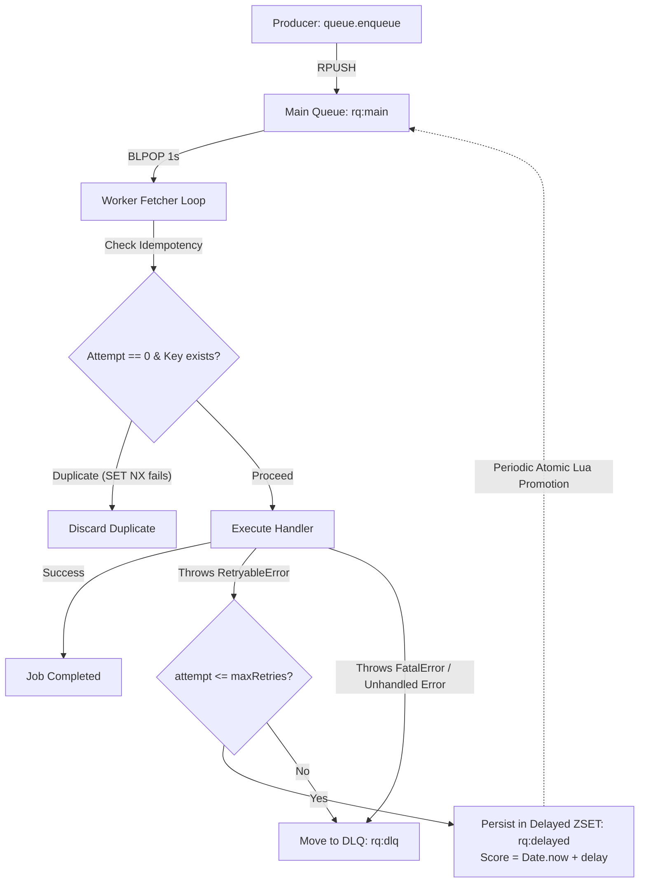
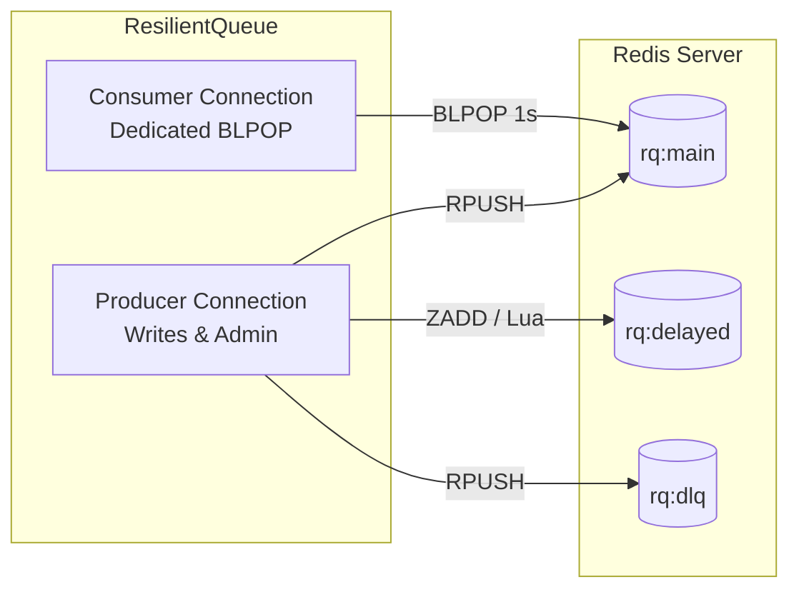

> [!NOTE]
> **Maintenance Mode**: This project is in maintenance mode. Contributions, bug fixes, and improvements are welcome! Please check out [CONTRIBUTING.md](./CONTRIBUTING.md) to get started.

# @mayurbhusare/resilient-queue

[](https://www.npmjs.com/package/@mayurbhusare/resilient-queue)
[](./LICENSE)
[](https://www.npmjs.com/package/@mayurbhusare/resilient-queue)
[](https://nodejs.org)
[](https://github.com/bhusareMayur/resilient-queue)
[](https://redis.io)

A lightweight, production-grade, Redis-backed job queue for Node.js.

Built for resilience, **`@mayurbhusare/resilient-queue`** provides **persistent exponential backoff retries**, **crash-proof delayed retry scheduling**, **Dead-Letter Queue (DLQ)** routing, **idempotency guarantees**, **in-memory worker concurrency**, and **graceful shutdown** — all with zero framework bloat and only two lean dependencies (`ioredis` and `uuid`).

---

## Table of Contents

- [Features](#-features)
- [Architecture & How It Works](#-architecture--how-it-works)
- [Installation](#-installation)
- [Quick Start](#-quick-start)
- [Core Concepts & Usage](#-core-concepts--usage)
  - [Producer (Enqueuing Jobs)](#1-producer-enqueuing-jobs)
  - [Consumer (Processing Jobs & Concurrency)](#2-consumer-processing-jobs--concurrency)
  - [Job Object Anatomy](#3-job-object-anatomy)
  - [Error Handling: Retryable vs. Fatal](#4-error-handling-retryable-vs-fatal)
  - [Crash-Durable Delayed Retries](#5-crash-durable-delayed-retries)
  - [Dead Letter Queue (DLQ)](#6-dead-letter-queue-dlq)
  - [Idempotency & Expiration (TTL)](#7-idempotency--expiration-ttl)
  - [Dual Redis Connection Architecture](#8-dual-redis-connection-architecture)
  - [Graceful Shutdown](#9-graceful-shutdown)
- [Complete API Reference](#-complete-api-reference)
- [Redis Keys Layout](#-redis-keys-layout)
- [Testing](#-testing)
- [Contributing](#-contributing)
- [License](#-license)

---

## ✨ Features

- 🚀 **Lightweight & Fast**: Built directly on top of `ioredis` with no heavy abstractions or multi-megabyte dependencies.
- 🔁 **Exponential Backoff**: Configurable retry limit and base delay with automatic exponential backoff (`baseDelay * 2^attempt`).
- 💾 **Crash-Durable Retries**: Scheduled retries are stored in Redis Sorted Sets (`rq:delayed`) and promoted atomically via Lua scripts. Even if your worker crashes or restarts, scheduled retries are never lost!
- ☠️ **Dead Letter Queue (DLQ)**: Automatically moves fatal errors or jobs exceeding `maxRetries` to `rq:dlq` with failure timestamps, attempts count, and reason.
- 🔒 **Idempotency Protection**: Built-in at-most-once processing with optional TTL expiration to safely deduplicate incoming jobs without blocking subsequent retries.
- ⚡ **Controlled Concurrency**: Configurable in-memory worker pool (`concurrency: N`) using an efficient single-fetcher loop with `Promise.race` backpressure to prevent Redis socket exhaustion.
- 🔌 **Dual Connection Design**: Separates blocking reads (`BLPOP`) from command writes (`RPUSH`, `SET`, `ZADD`) so queue operations are never stalled by consumer polling.
- 🛑 **Graceful Shutdown**: Built-in `queue.close()` and `queue.stop()` to drain active in-flight jobs and disconnect cleanly without data loss.

---

## 🧠 Architecture & How It Works



### Lifecycle Highlights:
1. **Enqueuing**: Jobs receive a unique UUID and are pushed to the Redis list `rq:main`.
2. **Dequeuing**: Workers fetch jobs using Redis `BLPOP` (1-second timeout for non-blocking shutdown responsiveness).
3. **Idempotency Check**: On `attempt === 0`, if an `idempotencyKey` is provided, Redis `SET NX` locks it. If it was already processed, the duplicate is skipped. Retries of the same job bypass this check.
4. **Execution**: If the handler throws a `RetryableError` and attempts remain, the job is persisted to `rq:delayed` (a Redis ZSET).
5. **Promotion**: An internal scheduler runs an atomic Lua script every 100ms that promotes due jobs from `rq:delayed` back to `rq:main`.
6. **Dead Lettering**: If a job exhausts all retries or throws any non-retryable error (such as `FatalError`), it is routed immediately to `rq:dlq`.

---

## 📦 Installation

```bash
# npm
npm install @mayurbhusare/resilient-queue

# yarn
yarn add @mayurbhusare/resilient-queue

# pnpm
pnpm add @mayurbhusare/resilient-queue
```

---

## 🚀 Quick Start

```javascript
const {
  ResilientQueue,
  RetryableError,
  FatalError
} = require("@mayurbhusare/resilient-queue");

// 1. Initialize Queue
const queue = new ResilientQueue({
  redisUrl: "redis://127.0.0.1:6379",
  maxRetries: 3,
  baseDelay: 500,    // 500ms base delay
  keyPrefix: "rq"     // Default Redis prefix
});

// 2. Start Processing Jobs (Worker)
queue.process(async (job) => {
  console.log(`[Job ${job.id}] Processing:`, job.data);

  if (job.data.shouldRetry) {
    // Retried with exponential backoff: 1s, 2s, 4s...
    throw new RetryableError("External service unavailable");
  }

  if (job.data.isCorrupt) {
    // Immediately moves to DLQ without retrying
    throw new FatalError("Invalid payload data");
  }

  console.log(`[Job ${job.id}] Completed successfully!`);
}, { concurrency: 2 });

// 3. Enqueue Jobs (Producer)
async function main() {
  const jobId = await queue.enqueue(
    { email: "user@example.com", template: "welcome" },
    { idempotencyKey: "welcome-user-123", ttlSeconds: 86400 }
  );

  console.log("Enqueued job with ID:", jobId);
}

main().catch(console.error);
```

---

## 💡 Core Concepts & Usage

### 1. Producer (Enqueuing Jobs)

Enqueue arbitrary JSON-serializable payloads. `enqueue()` returns a promise that resolves to the auto-generated unique job UUID:

```javascript
const jobId = await queue.enqueue({
  orderId: "order_9981",
  amount: 49.99
});

console.log("Created job ID:", jobId); // e.g. "550e8400-e29b-41d4-a716-446655440000"
```

To prevent duplicate job processing, supply an `idempotencyKey` and an optional expiration `ttlSeconds`:

```javascript
await queue.enqueue(
  { transactionId: "txn_abc123", amount: 100 },
  {
    idempotencyKey: "txn_abc123",
    ttlSeconds: 3600 // Expire idempotency lock after 1 hour
  }
);
```

---

### 2. Consumer (Processing Jobs & Concurrency)

Register an asynchronous handler with `queue.process(handler, options)`.

```javascript
queue.process(async (job) => {
  await sendNotification(job.data);
}, {
  concurrency: 5 // Process up to 5 jobs concurrently in this worker
});
```

#### Why In-Memory Concurrency Matters:
Unlike naive queue implementations that open a separate Redis socket per concurrent worker (leading to connection exhaustion and socket bottlenecks), `ResilientQueue` uses a **single consumer connection** with an internal in-memory active job set and `Promise.race` backpressure. When the active job limit is reached, fetching temporarily pauses until a slot opens up.

---

### 3. Job Object Anatomy

The `job` argument provided to your handler contains the following structure:

```json
{
  "id": "c1f7a0b2-9d33-4f27-a068-154df67f62c0",
  "data": {
    "userId": 42,
    "action": "send_welcome_email"
  },
  "attempt": 0,
  "idempotencyKey": "welcome-42",
  "ttlSeconds": 86400,
  "createdAt": 1713000000000,
  "lastError": "SMTP timeout",
  "retriedAt": 1713000001000
}
```

| Property | Type | Description |
| :--- | :--- | :--- |
| `id` | `string` | Unique UUID v4 for the job. |
| `data` | `any` | The payload passed during `enqueue()`. |
| `attempt` | `number` | Number of retries already executed (`0` on initial try, `1`, `2`, ... on retries). |
| `idempotencyKey` | `string \| null` | The idempotency key, if provided. |
| `ttlSeconds` | `number \| null` | The idempotency TTL in seconds, if specified. |
| `createdAt` | `number` | Unix timestamp (in milliseconds) when the job was created. |
| `lastError` | `string \| undefined` | The error message from the previous failed attempt (available on retries). |
| `retriedAt` | `number \| undefined` | Unix timestamp (in milliseconds) of the most recent retry attempt. |

---

### 4. Error Handling: Retryable vs. Fatal

`@mayurbhusare/resilient-queue` makes an intentional distinction between transient failures and non-recoverable errors:

```javascript
const { RetryableError, FatalError } = require("@mayurbhusare/resilient-queue");

queue.process(async (job) => {
  try {
    await callThirdPartyAPI(job.data);
  } catch (err) {
    if (err.isRateLimited || err.code === "ECONNRESET") {
      // ⏳ Transient error: retried up to maxRetries
      throw new RetryableError(`Rate limit reached: ${err.message}`);
    }

    // 🛑 Fatal error: moved straight to DLQ, skipping retries
    throw new FatalError(`Unrecoverable response: ${err.message}`);
  }
});
```

> [!IMPORTANT]
> **DLQ by Default for Non-Retryable Errors**: If your handler throws an unhandled standard `Error` (or a `FatalError`) that does **not** inherit from `RetryableError`, the queue treats it as permanent and routes the job directly to the DLQ on the very first attempt. Only errors explicitly inheriting from `RetryableError` undergo exponential retry.

---

### 5. Crash-Durable Delayed Retries

When a `RetryableError` is thrown, the retry delay is calculated using exponential backoff:

$$\text{delay} = \text{baseDelay} \times 2^{\text{attempt}}$$

| Attempt | Multiplier | Delay (with default `baseDelay: 500ms`) |
| :---: | :---: | :---: |
| 1st retry | $500 \times 2^1$ | **1,000 ms** (1.0 s) |
| 2nd retry | $500 \times 2^2$ | **2,000 ms** (2.0 s) |
| 3rd retry | $500 \times 2^3$ | **4,000 ms** (4.0 s) |

#### How Delayed Retries Survive Process Restarts
Instead of keeping delayed jobs in transient Node.js `setTimeout` memory timers, `ResilientQueue` persists delayed jobs into a Redis Sorted Set (`<keyPrefix>:delayed`) where the **score is the execution timestamp** (`Date.now() + delay`).

- A background scheduler inspects `<keyPrefix>:delayed` and runs an atomic Lua script that safely promotes due jobs back into `<keyPrefix>:main`.
- If your server reboots, worker process restarts, or the app is redeployed, **no scheduled retries are lost**. Due jobs are promoted and picked up immediately upon restart!

---

### 6. Dead Letter Queue (DLQ)

When a job either exceeds `maxRetries` or encounters a fatal non-retryable error, it is moved to the Dead Letter Queue:

```text
rq:dlq
```

Each entry in `rq:dlq` preserves the entire original job payload along with failure diagnostics:
```json
{
  "id": "e0b9b32a-5b12-429a-9e11-cf9787e91d89",
  "data": { "chargeId": "ch_123" },
  "attempt": 4,
  "idempotencyKey": "charge_ch_123",
  "ttlSeconds": null,
  "createdAt": 1713000000000,
  "lastError": "Gateway timeout",
  "retriedAt": 1713000008000,
  "failedAt": 1713000016000,
  "failureReason": "Gateway timeout"
}
```

#### Inspecting the DLQ
You can inspect or drain the DLQ directly using any Redis client or `ioredis`:

```javascript
const Redis = require("ioredis");
const redis = new Redis("redis://127.0.0.1:6379");

async function checkDeadLetterQueue() {
  // Fetch the latest 10 failed jobs
  const failedJobsRaw = await redis.lrange("rq:dlq", 0, 9);
  const failedJobs = failedJobsRaw.map((raw) => JSON.parse(raw));

  console.log(`Found ${failedJobs.length} failed jobs in DLQ:`);
  failedJobs.forEach((job) => {
    console.error(`Job ${job.id} failed after ${job.attempt} attempts: ${job.failureReason}`);
  });
}
```

---

### 7. Idempotency & Expiration (TTL)

To guarantee **at-most-once** delivery across distributed producers and retries:

```javascript
await queue.enqueue(
  { invoiceId: "INV-2026-001" },
  {
    idempotencyKey: "invoice:INV-2026-001",
    ttlSeconds: 86400 // Key expires after 24 hours
  }
);
```

#### How it works:
1. When a job is dequeued for the first time (`job.attempt === 0`), the worker executes a Redis `SET <keyPrefix>:idempotency:<key> 1 NX [EX ttl]`.
2. If another job with the same key has already been processed or is currently stored, Redis returns `null`, and the duplicate is safely discarded without executing the handler.
3. **Retries Are Never Blocked**: Once a job has started processing, any subsequent retry attempts (`job.attempt > 0`) bypass the idempotency check, ensuring retries continue to completion without deadlocking.

---

### 8. Dual Redis Connection Architecture

`ResilientQueue` initializes two distinct Redis connections under the hood:



- **Producer Connection**: Dedicated to immediate, non-blocking commands (`RPUSH`, `SET`, `ZADD`, `eval`, `quit`).
- **Consumer Connection**: Exclusively reserved for blocking reads (`BLPOP`).

Because `BLPOP` holds the connection socket open while waiting for new jobs, isolating the producer ensures your application can always enqueue new jobs, promote retries, or write to the DLQ with zero blocking delay.

---

### 9. Graceful Shutdown

In production environments (Kubernetes, Docker, PM2, systemd), workers need to finish executing in-flight jobs when a termination signal is received:

```javascript
// Clean shutdown hook
async function handleShutdown() {
  console.log("Shutting down worker gracefully...");
  
  // Stops fetching new jobs, awaits in-flight jobs, and closes Redis connections
  await queue.close();
  
  console.log("Worker closed cleanly.");
  process.exit(0);
}

process.on("SIGTERM", handleShutdown);
process.on("SIGINT", handleShutdown);
```

- `queue.stop()`: Halts job consumption, pauses retry schedulers, and waits for all in-flight jobs to settle.
- `queue.close()`: Executes `queue.stop()` and safely closes both Redis connections (`producer.quit()` and `consumer.quit()`).

---

## 📖 Complete API Reference

### `new ResilientQueue(options)`

Creates a new queue instance.

| Option | Type | Default | Description |
| :--- | :--- | :--- | :--- |
| `redisUrl` | `string` | *(Required)* | Redis connection URL (e.g. `"redis://127.0.0.1:6379"`). |
| `maxRetries` | `number` | `3` | Maximum number of retries before routing a failed job to DLQ. |
| `baseDelay` | `number` | `500` | Base retry delay in milliseconds for exponential backoff (`baseDelay * 2^attempt`). |
| `keyPrefix` | `string` | `"rq"` | Namespace prefix for all Redis keys created by this queue. |

---

### `queue.enqueue(data, [options])`

Pushes a new job to the tail of the main queue.

- **Parameters**:
  - `data` (`any`): Any JSON-serializable value representing the job payload.
  - `options` (`object`, optional):
    - `idempotencyKey` (`string`, optional): Unique key for deduplication.
    - `ttlSeconds` (`number`, optional): Time-to-live in seconds for the idempotency key in Redis.
- **Returns**: `Promise<string>` — The auto-generated UUID v4 string of the job.

---

### `queue.process(handler, [options])`

Starts consuming jobs from the queue.

- **Parameters**:
  - `handler` (`(job: object) => Promise<void>`): Async worker function. Receives the `job` object.
  - `options` (`object`, optional):
    - `concurrency` (`number`, optional): Positive integer specifying how many jobs can run concurrently in this worker. Default: `1`.
- **Returns**: `Promise<void>`

---

### `queue.stop()`

Stops the worker polling loop, clears the retry promotion timer, and waits for currently running in-flight jobs to complete.

- **Returns**: `Promise<void>`

---

### `queue.close()`

Calls `queue.stop()` and gracefully closes both producer and consumer Redis connections.

- **Returns**: `Promise<void>`

---

### `RetryableError`

```javascript
const { RetryableError } = require("@mayurbhusare/resilient-queue");
throw new RetryableError("Temporary failure message");
```
Error class indicating that the job encountered a recoverable failure and should be retried using exponential backoff.

---

### `FatalError`

```javascript
const { FatalError } = require("@mayurbhusare/resilient-queue");
throw new FatalError("Unrecoverable error message");
```
Error class indicating a permanent failure. Bypasses all retries and routes the job directly to the DLQ.

---

## 🗄️ Redis Keys Layout

All keys are namespaced by the configured `keyPrefix` (default: `rq`):

| Redis Key | Type | Description |
| :--- | :---: | :--- |
| `<keyPrefix>:main` | `List` | Primary FIFO queue where new and promoted jobs await consumption via `BLPOP`. |
| `<keyPrefix>:delayed` | `Sorted Set` | Scheduled retries waiting for their delay window to elapse. Score is the Unix timestamp (ms). |
| `<keyPrefix>:dlq` | `List` | Dead Letter Queue holding exhausted or fatal failed jobs with diagnostic metadata. |
| `<keyPrefix>:idempotency:<key>` | `String` | Idempotency lock stored via `SET NX` with optional TTL expiration (`EX`). |

---

## 🧪 Testing

The library includes an extensive test suite built with **Jest**, covering core queue behavior, retry backoff, DLQ routing, idempotency deduplication, crash recovery of delayed retries, concurrency limits, and graceful shutdown.

### Run Tests:
Ensure a local Redis instance is running on `127.0.0.1:6379`, then run:

```bash
npm test
```

---

## 🤝 Contributing

Contributions, issues, and feature requests are welcome!  
Please see [CONTRIBUTING.md](./CONTRIBUTING.md) for details on branching conventions, code style, and testing guidelines.

---

## 📄 License

This project is licensed under the [MIT License](./LICENSE).

Copyright (c) 2026 Mayur S. Bhusare.