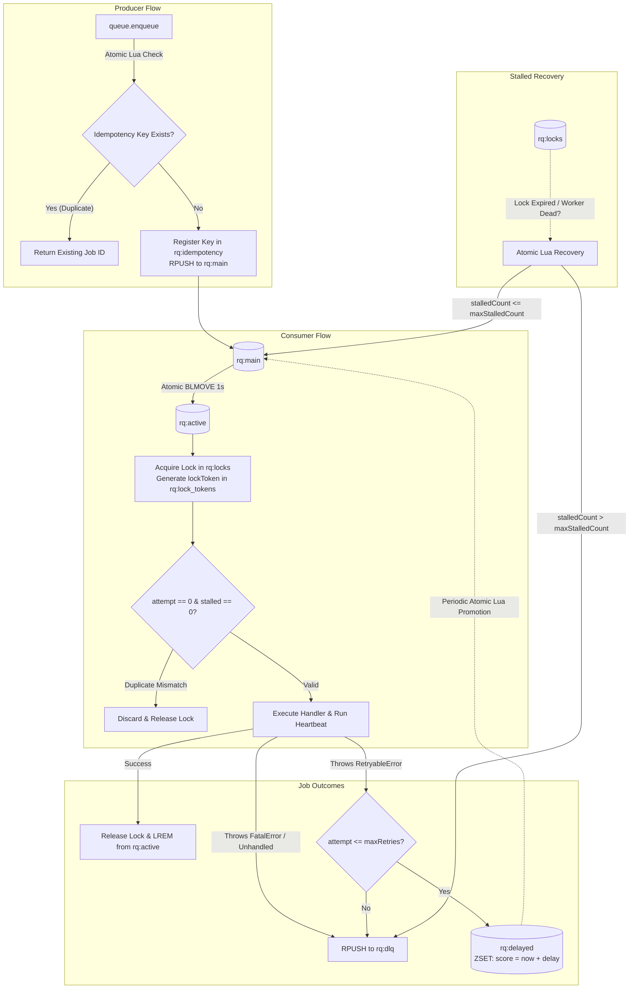
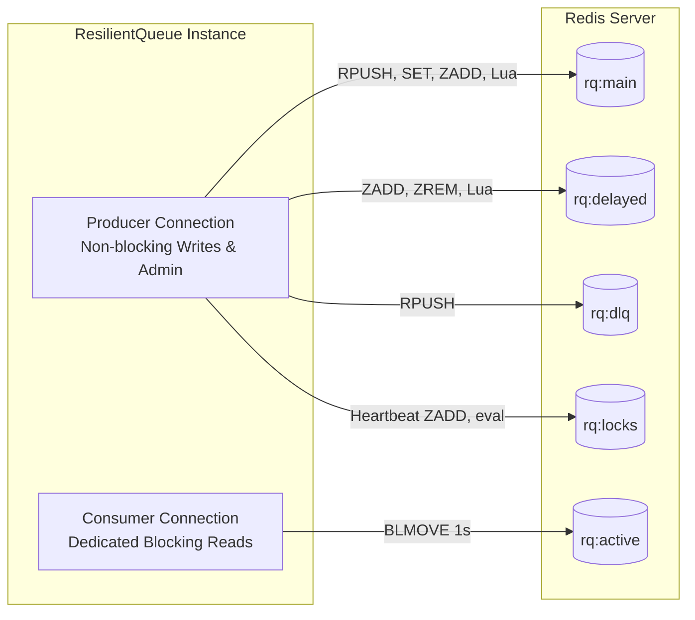

# Architecture & Internals

This document details the internal design, concurrency model, data flow, and distributed systems patterns implemented in `@mayurbhusare/resilient-queue`.

---

## Table of Contents

- [Design Philosophy](#design-philosophy)
- [System Architecture Diagram](#system-architecture-diagram)
- [Dual Redis Connection Model](#dual-redis-connection-model)
- [In-Memory Worker Concurrency Pool](#in-memory-worker-concurrency-pool)
- [Reliable Queue Pattern & Crash Durability](#reliable-queue-pattern-crash-durability)
  - [Atomic Dequeue](#atomic-dequeue)
  - [Visibility Locks & Heartbeat Renewal](#visibility-locks-heartbeat-renewal)
  - [Per-Dequeue Fencing Tokens](#per-dequeue-fencing-tokens)
  - [Lease Loss Detection & AbortSignal](#lease-loss-detection-abortsignal)
  - [Stalled Job Recovery Scheduler](#stalled-job-recovery-scheduler)
  - [Preserving Pristine Raw Payloads](#preserving-pristine-raw-payloads)
  - [Poison Pill Protection](#poison-pill-protection)
- [Crash-Durable Delayed Retries](#crash-durable-delayed-retries)
- [Atomic Enqueue-Time Idempotency](#atomic-enqueue-time-idempotency)
- [Dead-Letter Queue (DLQ) Lifecycle](#dead-letter-queue-dlq-lifecycle)

---

## Design Philosophy

Traditional in-memory or Redis `BLPOP` queues suffer from critical limitations in distributed production environments:
1. **Data Loss on Worker Crash**: If a worker dequeues a job via `BLPOP` and crashes immediately (due to OOM, `SIGKILL`, or hardware failure), the job is permanently lost.
2. **Volatile Timers**: Retries scheduled using Node.js `setTimeout` memory timers vanish if the worker restarts.
3. **Socket Bottlenecks**: Creating a separate Redis socket per concurrent worker thread quickly exhausts Redis connection limits.
4. **Stale Execution (Split-Brain)**: Delayed or paused workers can wake up and release or overwrite locks belonging to successor workers.

`ResilientQueue` addresses these challenges with zero heavy frameworks, relying solely on `ioredis` and atomic Redis primitives (Lua scripts, `BLMOVE`, and Sorted Sets).

---

## System Architecture Diagram



---

## Dual Redis Connection Model

Redis commands are executed sequentially per connection socket. A connection executing a blocking command (such as `BLMOVE` or `BRPOPLPUSH`) is held open by the Redis server until a job is pushed or the timeout expires.

Because a blocked socket cannot execute other commands, `ResilientQueue` establishes two separate Redis connections:



1. **Producer Connection**: Reserved for immediate commands (`RPUSH`, `SET`, `ZADD`, `eval`, heartbeats, DLQ routing).
2. **Consumer Connection**: Exclusively reserved for blocking reads (`BLMOVE` / `BRPOPLPUSH`).

This guarantees that enqueuing new jobs, heartbeating active locks, and promoting retries are never blocked by an idle consumer waiting for work.

---

## In-Memory Worker Concurrency Pool

Naive queue implementations often open a separate Redis socket per concurrent worker thread. With 50 instances each running 20 concurrent workers, this consumes $50 \times 20 = 1{,}000$ active Redis connections.

`ResilientQueue` solves this using a **single consumer connection** with an in-memory worker pool:
- Workers are orchestrated by a single fetcher loop.
- Dequeued jobs are placed in an internal `Set` of active Promises (`this.activeJobs`).
- When `this.activeJobs.size >= concurrency`, the fetcher pauses using `await Promise.race(this.activeJobs)`.
- As soon as any running job settles, a slot opens up, and the fetcher immediately pulls the next job.

This maintains high concurrency with predictable, constant connection overhead: **exactly 2 Redis connections per process**, regardless of the configured concurrency level.

---

## Reliable Queue Pattern & Crash Durability

### Atomic Dequeue

Jobs are fetched using Redis `BLMOVE` (Redis 6.2+) with automatic fallback to `BRPOPLPUSH` for Redis 5.x:

```redis
BLMOVE rq:main rq:active LEFT RIGHT 1
```

This ensures atomicity:
- The job is moved from `rq:main` to `rq:active` in a single Redis operation.
- **The job is never deleted from Redis during execution.**
- If the worker process is killed (`SIGKILL`, OOM, reboot), the job remains in `rq:active`.

### Visibility Locks & Heartbeat Renewal

Immediately upon dequeuing:
1. The worker records a visibility lock in `rq:locks` with an expiration timestamp (`Date.now() + lockDuration`).
2. A lightweight background timer (`setInterval`) fires at one-third of the lock duration (`Math.floor(lockDuration / 3)`), refreshing the timestamp in `rq:locks` as long as the worker remains alive.

### Per-Dequeue Fencing Tokens

In distributed environments, a worker may experience a stop-the-world garbage collection pause or network blip exceeding its `lockDuration`. During this pause, the recovery scheduler may declare the job stalled and assign it to a successor worker.

To prevent the stale worker from releasing or renewing the successor worker's lock when it wakes up, each dequeue generates a unique **fencing token** (`lockToken` UUID):
- The token is recorded in `rq:lock_tokens`.
- Lock renewal (`renewLock`) and lock release (`releaseLock`) execute atomic Lua scripts that verify that the caller's `lockToken` matches the token currently stored in `rq:lock_tokens`.
- If the token does not match, the operation fails safely without altering successor state.

### Lease Loss Detection & AbortSignal

When a worker's lock token is superseded or expires:
1. The heartbeat detects renewal failure.
2. The queue sets `job.isLeaseLost = true`.
3. If an `AbortController` was attached, `job.signal` is triggered with an abort reason.

Handlers can inspect `job.signal.aborted` or pass `job.signal` to abort-aware APIs (such as `fetch`) to terminate work immediately upon lease loss.

### Stalled Job Recovery Scheduler

A background scheduler periodically runs the `recoverStalledJobs` Lua script:
1. Finds jobs in `rq:locks` whose score is $\le \text{Date.now()}$.
2. Matches each expired ID to an entry in `rq:active`.
3. Atomically removes the job from `rq:active`, cleans up its expired lock and token, and either re-queues it into `rq:main` or routes it to `rq:dlq`.

### Preserving Pristine Raw Payloads

Many Redis Lua scripts decode and re-encode JSON payloads using Lua's `cjson` module. However, `cjson.decode` and `cjson.encode` mutate empty JSON arrays (`[]`) into empty objects (`{}`), corrupting typed data.

`ResilientQueue` avoids this corruption:
- The recovery Lua script moves the **original raw string** directly between `rq:active`, `rq:main`, and `rq:dlq` without re-encoding the payload.
- Recovery metadata (`stalledCount`, `lastStalledAt`, `attempt`) is stored externally in a separate Redis Hash (`rq:stalled_meta`).
- When a worker picks up a recovered job, it merges the metadata into the job object in Node.js.

### Poison Pill Protection

If a corrupted job causes workers to crash repeatedly, the recovery scheduler tracks `stalledCount`. When `stalledCount > maxStalledCount` (default: `1`), the job is diverted straight to `rq:dlq` with a diagnostic failure reason, preventing infinite crash loops.

---

## Crash-Durable Delayed Retries

When a handler throws a `RetryableError` and retry attempts remain:
1. The retry delay is computed using exponential backoff:
   $$\text{delay} = \text{baseDelay} \times 2^{\text{attempt}}$$
2. The job is persisted into a Redis Sorted Set (`rq:delayed`) where the **score is the execution timestamp** (`Date.now() + delay`).
3. An active worker promotion scheduler periodically executes an atomic Lua script:
   - Queries `rq:delayed` for entries with score $\le \text{Date.now()}$.
   - Atomically removes due entries (`ZREM`) and pushes them to `rq:main` (`RPUSH`).

Because retries are stored directly in Redis rather than in-memory Node.js timers, scheduled retries survive process reboots and redeployments.

---

## Atomic Enqueue-Time Idempotency

When `queue.enqueue(data, { idempotencyKey, ttlSeconds })` is called:
1. An atomic Redis Lua script executes against `rq:idempotency:<idempotencyKey>`:
   - If the key exists, Redis immediately returns the existing job ID without pushing a new job.
   - If the key does not exist, Redis sets the key to the candidate job ID (with optional `EX` expiration) and pushes the job payload to `rq:main`.
2. As a defense-in-depth measure, workers verify during dequeue that the job ID matches the registered idempotency key on initial execution (`attempt === 0`).
3. Subsequent retries (`attempt > 0`) and recovered stalled jobs (`stalledCount > 0`) bypass idempotency checks, ensuring in-flight jobs run to completion.

---

## Dead-Letter Queue (DLQ) Lifecycle

Jobs are routed to `rq:dlq` under four conditions:
1. A handler throws a `FatalError`.
2. A handler throws an unhandled error that does not inherit from `RetryableError`.
3. A job exceeds `maxRetries` following successive `RetryableError` throws.
4. A job exceeds `maxStalledCount` following worker crashes.

DLQ entries preserve the entire original payload, appended with diagnostic properties:
- `failedAt`: Unix timestamp in milliseconds when the job entered the DLQ.
- `failureReason`: Description of the error or stall threshold exceeded.
- `lastError`: Error message from previous attempts.
- `attempt`: Final attempt count.
